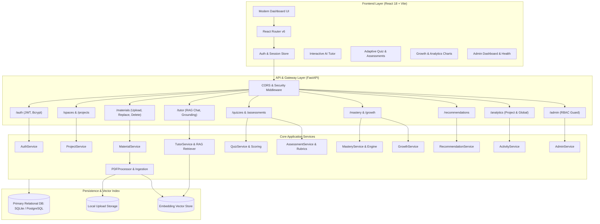
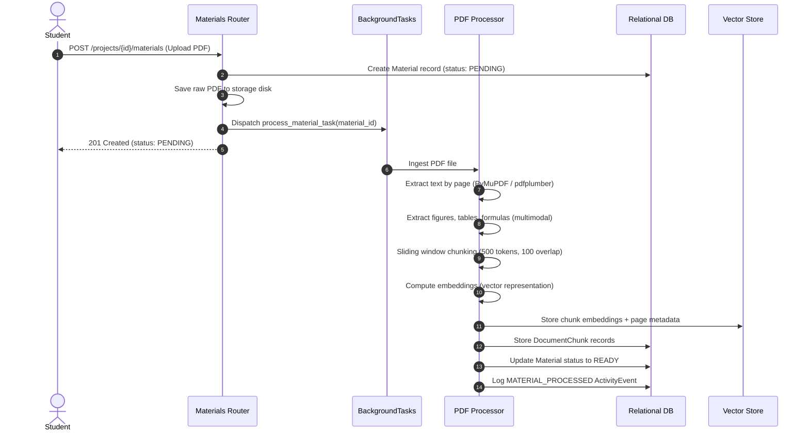
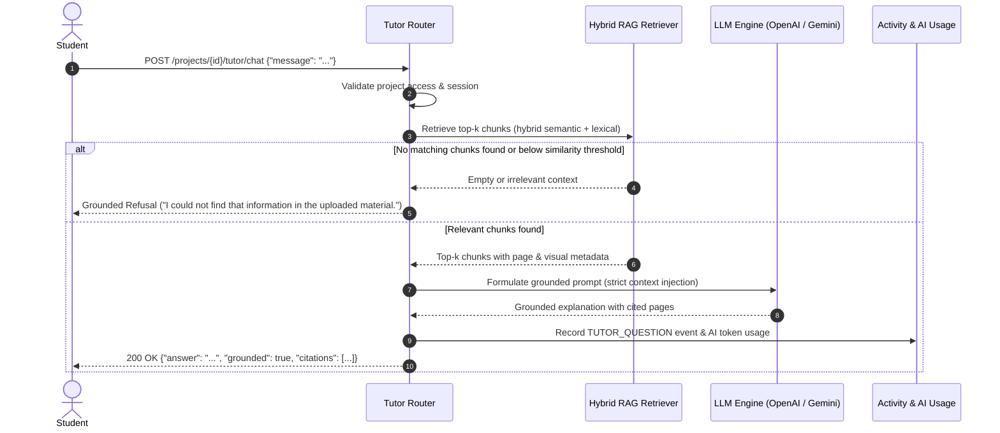
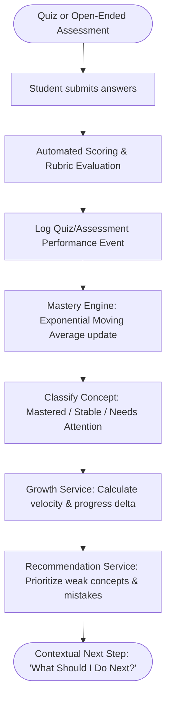
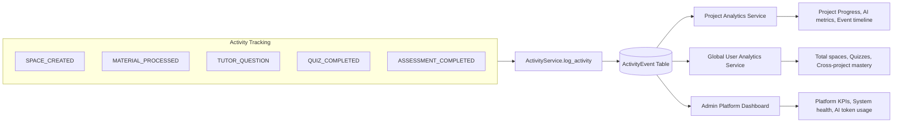

# AI Study Companion — System Architecture

## 1. System Overview

The **AI Study Companion** is an enterprise-grade, multi-tenant personalized learning platform built with a high-performance Python FastAPI backend and a responsive React (Vite) frontend. The platform structures student learning hierarchically into **Spaces** (academic domains) and **Projects** (targeted courses or topics).

Students upload course materials (PDFs), which are ingested through an asynchronous text and multimodal extraction pipeline, chunked, and embedded into a vector retrieval index. An intelligent **AI Study Tutor** utilizes grounded Retrieval-Augmented Generation (RAG) with precise page-level citations, refusing unsupported queries without hallucinating.

The platform continuously tracks student learning through **Adaptive Knowledge Quizzes**, **Open-ended Rubric Assessments**, **Concept Mastery Tracking**, **Growth Analysis**, **Contextual Learning Recommendations**, and an **Enterprise Admin Dashboard** with AI usage analytics and system health metrics.

---

## 2. High-Level Architecture Diagram

---

## 3. Detailed Data Flows

### 3.1 PDF Upload, Processing, Chunking & Vector Indexing

### 3.2 Tutor RAG Retrieval, Grounding & Refusal

### 3.3 Assessment, Mastery Tracking, Growth & Recommendations

### 3.4 Activity Tracking & Analytics Aggregation

---

## 4. Security & Data Isolation Architecture

1. **Authentication (JWT & Bcrypt)**:
   - Password hashing uses salted `bcrypt` with work factor 12.
   - Stateless signed JWT access tokens containing user ID, email, and role claims.
   - Configurable expiration (default 24 hours).
2. **Multi-Tenant Ownership Isolation**:
   - Every database query for Spaces, Projects, Materials, Conversations, Quizzes, Assessments, Mastery, Growth, and Recommendations enforces `user_id == current_user.id`.
   - Access to another user's resource strictly returns `404 Not Found`, preventing resource enumeration or IDOR (Insecure Direct Object Reference) vulnerabilities.
3. **Role-Based Access Control (RBAC)**:
   - Dedicated `ADMIN` role.
   - Admin router endpoints (`/admin/*`) are protected by `get_current_admin_user` dependency.
   - Non-admin authenticated users receive `403 Forbidden` with a clean error payload.
4. **Input Validation & Sanitization**:
   - Pydantic v2 schemas enforce strict types, bounds, string length constraints, and required fields.
   - File uploads are validated for valid PDF signatures (`%PDF-`), rejecting empty, corrupted, or malicious MIME types.
   - Standardized FastAPI exception handlers ensure that no raw Python tracebacks or internal database exception details leak to the client.

---

## 5. Technology Choices & Rationale

| Component | Selected Technology | Rationale |
| :--- | :--- | :--- |
| **Backend Framework** | **FastAPI** | High-throughput asynchronous performance, automatic OpenAPI documentation, native Pydantic v2 integration, and native `BackgroundTasks` for non-blocking file processing. |
| **ORM & Database** | **SQLAlchemy 2.0 + SQLite / PostgreSQL** | Database portability: seamless local SQLite operation with zero configuration, instantly swappable to PostgreSQL in cloud deployments via `DATABASE_URL`. |
| **PDF Extraction** | **PyMuPDF (`fitz`) / pdfplumber** | Lightning-fast page-by-page text extraction with native layout awareness, page number preservation, and tabular data extraction. |
| **Frontend Framework** | **React 18 + Vite** | Instant Hot Module Replacement (HMR), optimized production tree-shaking, predictable unidirectional component state, and rich declarative routing via React Router v6. |
| **Testing** | **Pytest + Starlette TestClient** | Standardized, blazing-fast unit and integration testing with isolated database sessions, deterministic fixture rollbacks, and reproducible E2E assertion scripts. |
